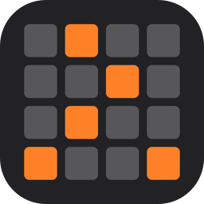
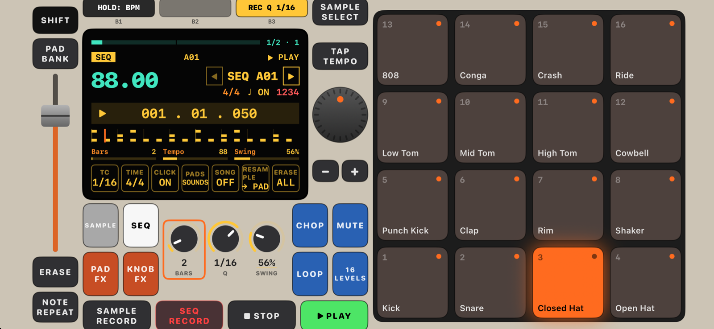
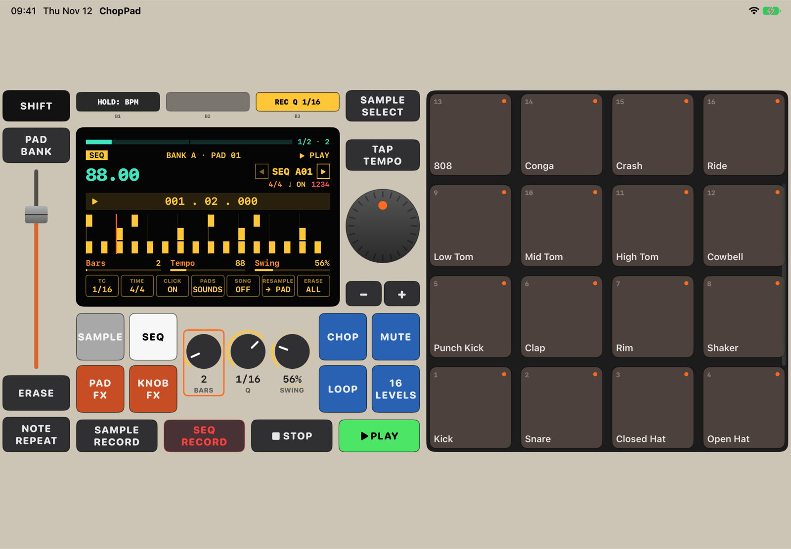
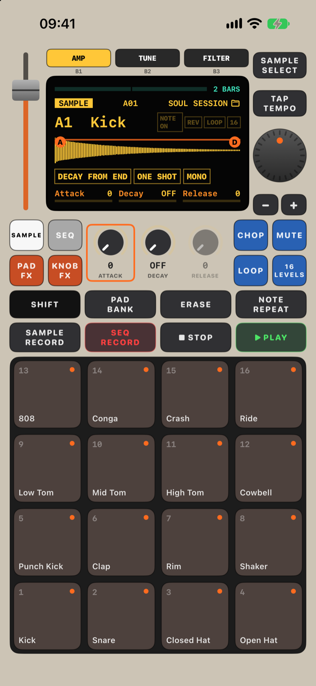
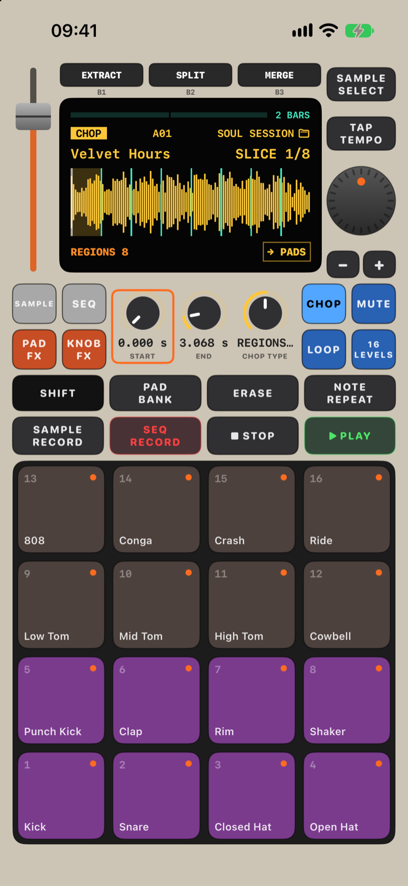
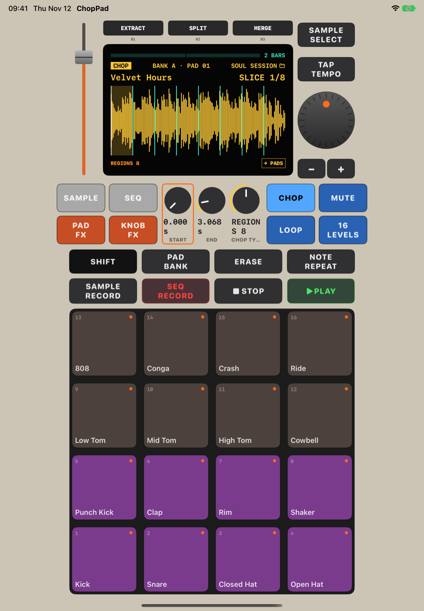

<p align="center">
  
</p>

<h1 align="center">ChopPad</h1>

<p align="center"><i>Chop songs into pads and make beats on your iPhone.</i></p>

<p align="center">
  <a href="https://github.com/hertn/ChopPad-app/releases/latest"></a>
  <a href="https://github.com/hertn/ChopPad-app#install-with-sidestore"></a>
  <a href="https://ko-fi.com/hertn"></a>
</p>

A pad sampler for iPhone and iPad (iOS 17 or later). Pick a song from your music library or record a sound with the mic, chop it into slices, drop them on pads, and make beats with a built-in drum kit and a looping sequencer.

<table align="center">
  <tr>
    <td colspan="3" align="center">
      <br>
      <sub><b>iPhone</b> · A beat playing on the SEQ screen</sub>
    </td>
    <td colspan="3" align="center">
      <br>
      <sub><b>iPad</b> · The same panel, square pads on the right</sub>
    </td>
  </tr>
  <tr>
    <td colspan="2" align="center">
      <br>
      <sub><b>iPhone</b> · The full panel in portrait</sub>
    </td>
    <td colspan="2" align="center">
      <br>
      <sub><b>iPhone</b> · CHOP: a record cut into 8 slices</sub>
    </td>
    <td colspan="2" align="center">
      <br>
      <sub><b>iPad</b> · CHOP in portrait</sub>
    </td>
  </tr>
</table>

## Install with SideStore

1. Open **SideStore → Sources → +**
2. Paste this source URL:

   ```
   https://raw.githubusercontent.com/hertn/ChopPad-app/main/source.json
   ```

3. Find **ChopPad** in the source and tap **Get**.

New versions show up in SideStore as updates (pull down in **My Apps** to check). The source also works in AltStore.

**Direct download:** [ChopPad.ipa (latest)](https://github.com/hertn/ChopPad-app/releases/latest/download/ChopPad.ipa), or see [all releases](https://github.com/hertn/ChopPad-app/releases).

## Features

Laid out like a hardware pad sampler, with the pads front and center. **[Read the manual](MANUAL.md)** for how everything works.

- **A hardware-style panel**: one main screen with B1–B3 keys above it and K1–K3 knobs below, a DATA WHEEL, a FADER and 16 square pads. Recording, kits, chopping and the song list are all pages of the one screen.
- **8 banks × 16 pads** (A–H), with a drum kit on bank A and five factory kits to start from.
- **Sample your own songs**: songs stored on your iPhone (not Apple Music streams) or from the Files app. Pick the part of a long song first, change the pitch without changing the speed, then chop at every hit, into 4, 8 or 16 even regions, or live: hit any pad and the song plays, and each slice lands on the pad you hit.
- **Record sounds** from the mic or an audio interface, or resample ChopPad itself, free or exactly one sequence long. SAMPLE RECALL catches the last 30 seconds you played.
- **Shape each pad**: TRIM (start, end, loop point), MIX (level, reverb, pan), AMP (attack, decay, release), TUNE (semitones, cents, WARP to the tempo by pitch or time stretch), PLAY (mono/poly, mute group, pad link), FILTER and a filter envelope.
- **Sequencer**: 128 sequences up to 128 bars, time signatures, count-in, metronome, swing, rec quantize and time correct, step edit, half/double speed, note repeat with triplets, song mode, fader automation, and resample a sequence onto a pad.
- **PAD FX**: 16 effects over the whole beat, played from the pads, plus FLEX BEAT for beat-repeat style effects.
- **KNOB FX**: vintage, vinyl, tape, delay, filter, pump or compressor, on every pad or on the pads you choose.
- **16 LEVELS**: one sound across all 16 pads by pitch, velocity or filter.
- **Kits**: save and load whole projects; your recordings and samples are saved with them.
- **Haptics**: pads, keys and knobs tap back.
- iPhone and iPad, portrait and landscape, in one app.

## Support

ChopPad is free, with no ads or subscriptions. If you enjoy it, you can [buy me a coffee on Ko-fi](https://ko-fi.com/hertn).

## Credits

Made by [hertn](https://github.com/hertn). ChopPad is built with Claude, Anthropic's AI: hertn designs and tests the app, Claude writes the code. The version number and credits are in the app under kits (SHIFT + pad 16) → ABOUT.

## License

All rights reserved. This repo hosts the app's downloads; you're welcome to install it for personal use. See [LICENSE](LICENSE).
