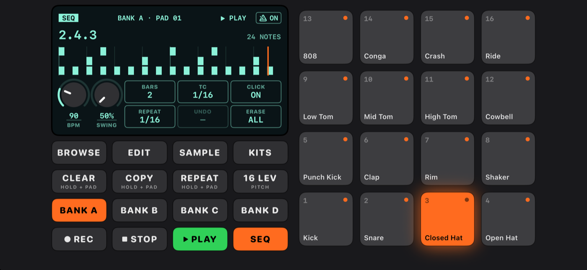
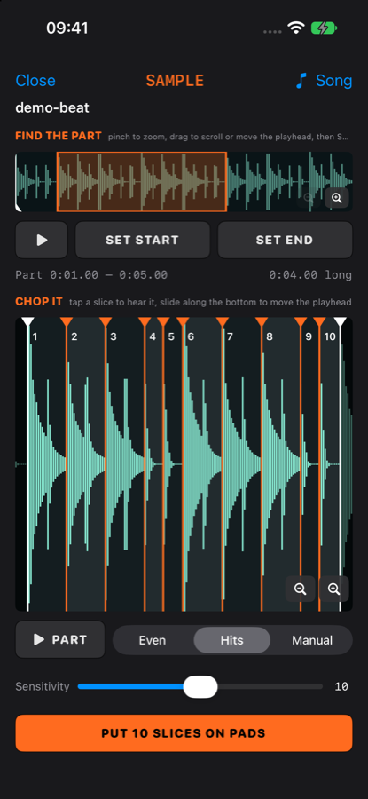
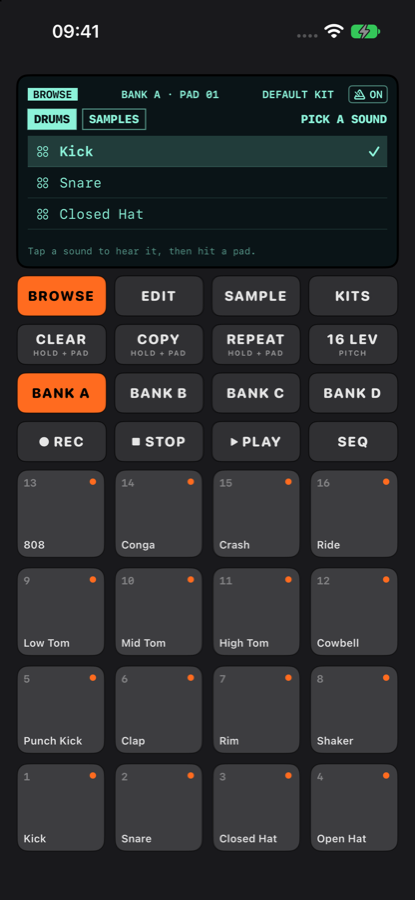

# ChopPad

An MPC-style sampler for iPhone. Pick a song from your music library, chop it into slices, drop them on pads, and make beats with a built-in drum kit and a looping sequencer.

<p align="center">
  
</p>
<p align="center">
  
  
</p>

## Install with SideStore

1. Open **SideStore → Sources → +**
2. Paste this source URL:

   ```
   https://raw.githubusercontent.com/hertn/ChopPad-app/main/source.json
   ```

3. Find **ChopPad** in the source and tap **Get**.

New versions show up in SideStore as updates (pull down in **My Apps** to check). The source also works in AltStore.

**Direct download:** [ChopPad.ipa (latest)](https://github.com/hertn/ChopPad-app/releases/latest/download/ChopPad.ipa), or see [all releases](https://github.com/hertn/ChopPad-app/releases).

## Features

- **Sample your own songs**: load MP3s and other songs stored on your iPhone (not Apple Music streaming tracks) or audio from the Files app.
- **Chop**: split a region into even slices, auto-detect hits, or place markers by hand, then assign the slices to pads in one go.
- **4 banks × 16 pads**, with a 16-sound drum kit on bank A out of the box.
- **Change pad sounds easily**: BROWSE loads a drum or sample onto the selected pad; TUNE, LEVEL and PAN knobs on the screen; EDIT for trim, reverse, one-shot/hold and mute groups.
- **Hold-and-tap functions** like an MPC: hold CLEAR or COPY and tap pads (tap the button once to lock it on).
- **Sequencer**: record what you play into a 1, 2 or 4 bar loop with count-in, metronome, timing correct, swing, undo and erase.
- **Note Repeat**: hold REPEAT and a pad for rolls at 1/4 to 1/32, including triplets.
- **16 Levels**: spread one sound across all 16 pads at different pitches.
- **Kits**: save and load whole setups, including their sequences.
- Works in portrait and landscape.

## License

All rights reserved. This repo hosts the app's downloads; you're welcome to install it for personal use. See [LICENSE](LICENSE).
